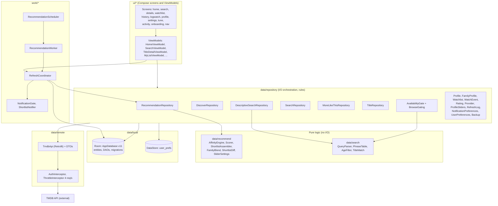
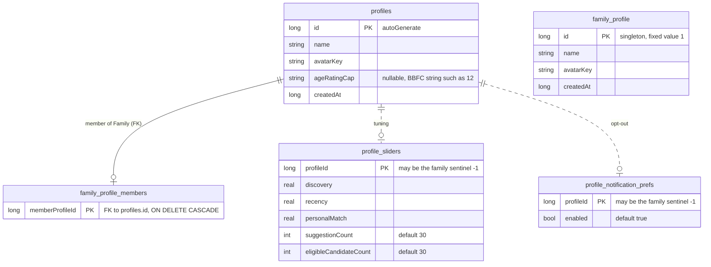
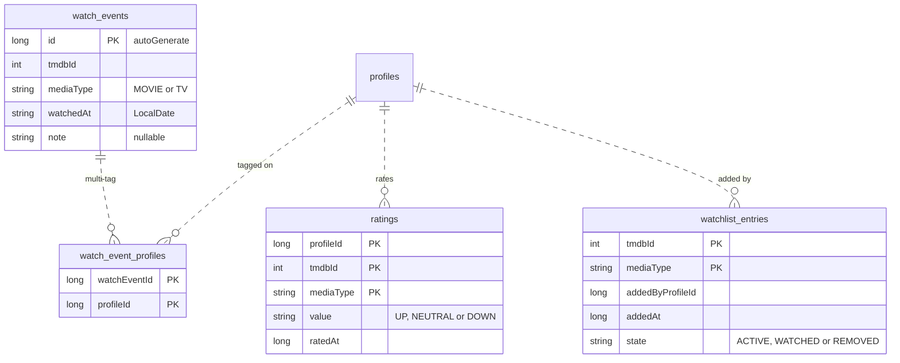
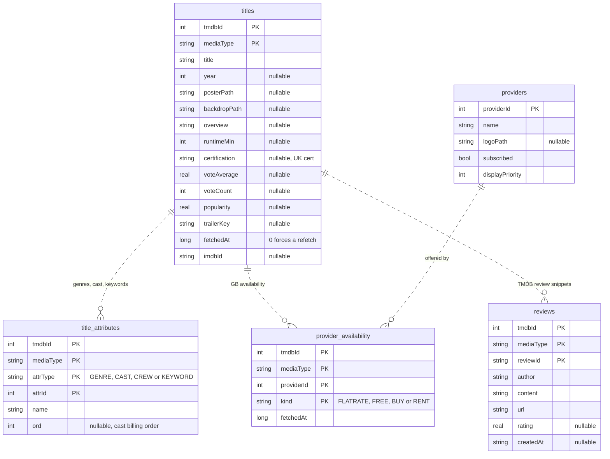
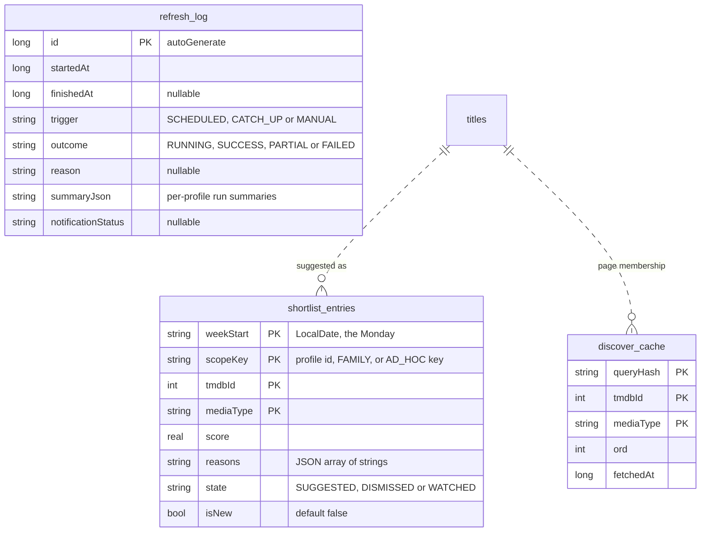
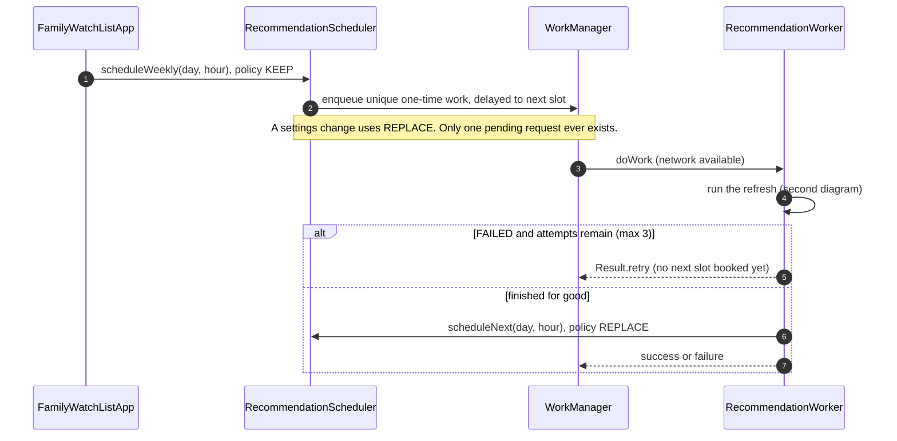
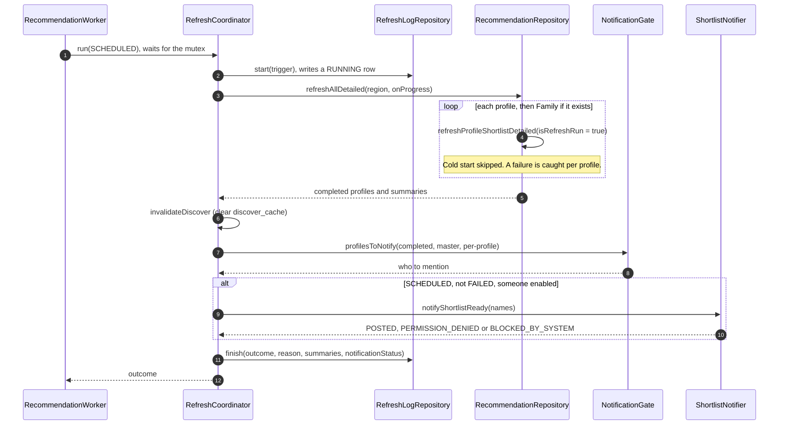
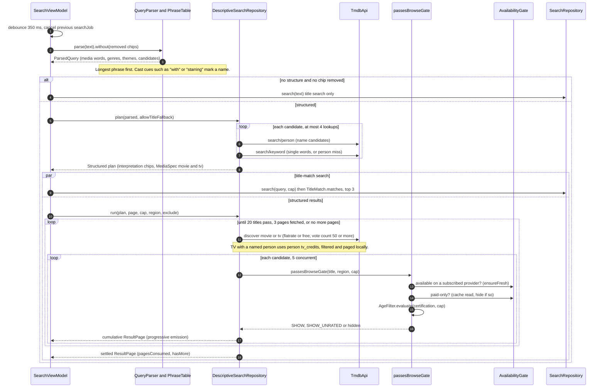
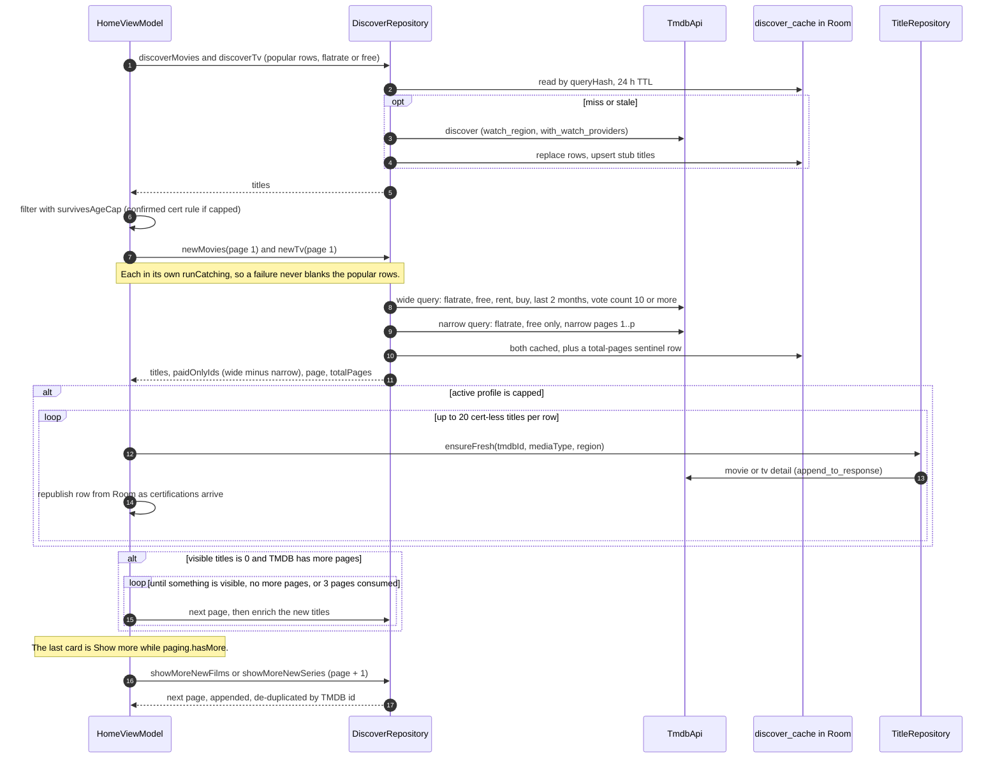
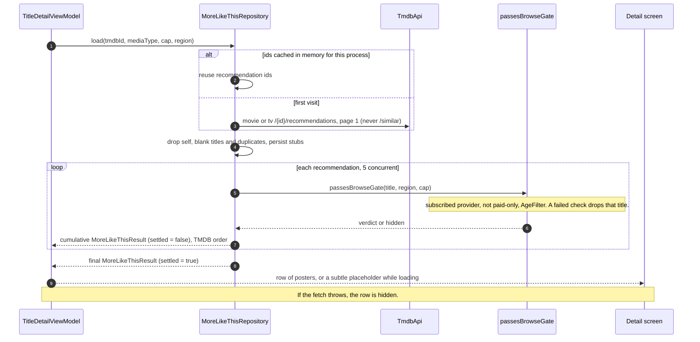

# Family Watchlist: architecture

Android app (Kotlin, Jetpack Compose) that tracks what a family watched, learns each person's taste
locally, and recommends titles that are on the family's UK streaming services, using TMDB as the
only data source.

This file describes the app **as the code is now** (version `0.1.0-alpha.21`, Room schema v11). It is
written for a new engineer or a cold Claude session. Where it disagrees with the older planning
documents, the code wins and the disagreement is listed in [Doc/code discrepancies](#doccode-discrepancies).

Related documents:

- [`PLAN.md`](../PLAN.md): the approved spec (data model section 2, TMDB section 3, recommender section 4, screens section 5, milestones section 7).
- [`PROGRESS.md`](../PROGRESS.md): the living checklist, with dated decisions.
- [`docs/adr/README.md`](adr/README.md): the architecture decision records (why things are the way they are).
- [`docs/TESTING.md`](TESTING.md): how the code is tested.
- [`docs/PREVIEW.md`](PREVIEW.md): how to view the app from a laptop or phone.

All source paths below are relative to `app/src/main/java/org/seg7/familywatchlist/`.

## Contents

1. [Purpose and constraints](#purpose-and-constraints)
2. [Main parts](#main-parts)
3. [Data model](#data-model)
4. [Key flows](#key-flows)
5. [Where cross-cutting rules are enforced](#where-cross-cutting-rules-are-enforced)
6. [Doc/code discrepancies](#doccode-discrepancies)
7. [How to keep this current](#how-to-keep-this-current)

## Purpose and constraints

These are the rules that shape every design choice. Each one is enforced in a specific place (see
[Where cross-cutting rules are enforced](#where-cross-cutting-rules-are-enforced)).

| Constraint | What it means in practice |
|---|---|
| Offline-first ([ADR 0001](adr/0001-offline-first-the-ui-reads-room-only-tmdb.md)) | The UI reads Room only. TMDB responses fill the cache; screens never render a network response directly. A passive Home visit makes no network call for the For You row, because it reads the persisted weekly shortlist. |
| UK region | `watch_region=GB` is the default and the intended region everywhere. The region is held in `UserPreferencesRepository.region` and threaded through as a call-time parameter (see the discrepancy note on region). See [ADR 0019](adr/0019-region-defaults-to-gb-uk-but-is-a.md). |
| No inference in the app | There is no on-device model and no LLM call. Descriptive search is a deterministic parser over lookup tables (`PhraseTable`) plus TMDB `search/person` and `search/keyword` lookups. Recommendation is plain content-based scoring (`data/recommend`). |
| At most 10 profiles | `ProfileRepository.MAX_PROFILES = 10`, checked in `addProfile`. The Family profile is a separate singleton and does not count. |
| Attribution | "Streaming data by JustWatch" must appear wherever availability renders (`ui/components/AvailabilityRow` pairs badges with the credit, and Home, Search, My List, Settings and onboarding carry it). The TMDB logo and the required not-endorsed notice appear in Settings, About and on onboarding. |
| Free-to-browse rule | Browsing never nudges towards rent or buy. One signed-off exception exists (New films on Home). |
| Throttled TMDB | One OkHttp interceptor limits all API traffic to 4 requests per second. |

## Main parts

The app is a conventional layered design with a hand-written DI container
(`di/AppContainer.kt`, one instance on `FamilyWatchListApp`, no Hilt).

### Package map

| Package | Contents | Notes |
|---|---|---|
| `ui/*` | One package per screen area: `home`, `search`, `details`, `watchlist`, `history`, `logwatch`, `profile`, `settings`, `tune`, `activity`, `onboarding`, `nav`, plus shared `components`, `theme`, `avatar`. | A ViewModel per screen. ViewModels get their repositories from `AppContainer` via `ui/LocalAppContainer`. `ui/nav/MainScaffold` owns the nav graph (bottom tabs Home, Search, My List, History, Settings, plus routes for details, Tune my picks, Activity, About). |
| `data/repository` | The classes in the diagram above, plus `TmdbMappers` (DTO to entity), `BrowseGating` (`passesBrowseGate`, `persistStubs`) and `BackupRepository` (JSON export and import of user data only). | The only layer that touches both Room and TMDB. |
| `data/local` | `AppDatabase` (v11, 17 entities, 10 migrations), `Converters`, `entity/*`, `dao/*`. | Schemas are exported (`exportSchema = true`). The database file is `family_watchlist.db`. |
| `data/remote` | `TmdbApi` (Retrofit interface), `TmdbClient` (builds Retrofit with kotlinx.serialization), `AuthInterceptor`, `ThrottleInterceptor`, `dto/*`. | The bearer token comes from `BuildConfig` (from the git-ignored `local.properties`). Never log it. |
| `data/recommend` | `AffinityEngine`, `Scorer`, `ShortlistAssembler`, `FamilyBlend`, `ShortlistDiff`, `SliderSettings`, `RecommenderSpec`, `ExtraPicks`, `FamilyNightProgress`, `AttrKey`. | Pure Kotlin, fixture-tested. `RecommenderSpec` holds the spec constants (half-life 180 days, weights 0.70 / 0.15 / 0.15, shortlist size 30). |
| `data/search` | `QueryParser`, `PhraseTable`, `AgeFilter`, `TitleMatch`. | Pure and deterministic. |
| `work/*` | `RecommendationScheduler`, `RecommendationWorker`, `RefreshCoordinator`, `RefreshSlots`, `NotificationGate`, `ShortlistNotifier`. | WorkManager and the notification. |
| `di/AppContainer` | Lazy singletons for every repository, the database, the TMDB client and the coordinator. | Construction order is documented inline. |

### Two image-loading and DataStore details worth knowing

- Poster images use a separate, plain OkHttp client in `FamilyWatchListApp.newImageLoader`, so image
  requests neither carry the TMDB bearer token nor go through the 4 req/s throttle.
- Small preferences (onboarding done, active profile, region, accent, refresh day and hour,
  notification master switch, family blend slider) live in DataStore (`UserPreferencesRepository`),
  not Room. The per-profile notification opt-out is in Room (`profile_notification_prefs`).

## Data model

The schema below is taken from the Room entities in `data/local/entity/*` and the
`@Database` list in `data/local/AppDatabase.kt` (version 11). Enums are stored as text through
`Converters`; `LocalDate` is stored as text; the diagrams show them as `string`. Only
`family_profile_members` declares a real foreign key. Every other link is a logical reference by id
(dotted lines), which is why deleting a profile does not cascade into ratings or events by itself.

### People, activity and preferences

*People and Family*

*Activity*

Notes:

- `profile_sliders` and `profile_notification_prefs` use the sentinel id `FAMILY_PROFILE_SENTINEL_ID = -1`
  for the Family profile, so Family has its own sliders, shortlist and notification toggle without a
  row in `profiles`.
- There is no row in either `profile_*` table until the user changes something. A missing row reads as
  the default at the repository layer, so migrations never backfill.

### Title cache, availability and recommendations

*Title cache and availability*

*Recommendations and caches*

Notes:

- `titles`, `title_attributes`, `provider_availability` and `reviews` are all filled by **one** TMDB
  detail call with `append_to_response`, so logging a watched title costs a single request.
- `discover_cache` has one row per (query hash, title) with `ord` preserving TMDB's order. A
  paged query also stores a sentinel row under the key `<queryHash>#pages` whose `tmdbId` column
  holds TMDB's `total_pages` (see [the cache keys](#cache-ttls-and-discover_cache-keys)).
- `shortlist_entries.weekStart` is the Monday of the week, regardless of the configured refresh day.
  `scopeKey` is the profile id as text, `FAMILY` for the persisted Family scope, or `AD_HOC:<ids>`
  for the Family Night chip-row subsets (only DISMISSED placeholder rows are ever written for those).
- `refresh_log` keeps the newest 20 rows (`RefreshLogDao.KEEP_LATEST`).
- Backup and restore (`BackupRepository`) covers user data only (profiles, watch events, ratings,
  watch list entries, subscribed providers). Everything TMDB-derived is refetchable and excluded.

### Migration history

Decisions: [ADR 0028](adr/0028-explicit-room-migrations-schemas-exported-no-destructive-fallback.md).

Registered in `AppContainer` (`Room.databaseBuilder(...).addMigrations(...)`); there is no
destructive fallback. Each one is defined in `data/local/AppDatabase.kt`.

| Migration | Change | Why / notes |
|---|---|---|
| `MIGRATION_1_2` | Adds `titles.trailerKey`. | Spec called for it at M1 and it was missed. A real migration because `titles` also holds metadata for watch list and history items. Existing rows get NULL until their next TTL refresh. |
| `MIGRATION_2_3` | Adds `titles.voteCount`. | The recommender's quality term needs a minimum-votes floor. A NULL count scores 0 until refreshed. |
| `MIGRATION_3_4` | Creates `profile_sliders` (discovery, recency, personalMatch). | Companion table rather than columns on `profiles`. No seed rows. |
| `MIGRATION_4_5` | Adds `profile_sliders.suggestionCount` and `eligibleCandidateCount`, both `NOT NULL DEFAULT 30`. | Slider 5: requested count versus the real number of eligible candidates (the slider's maximum). |
| `MIGRATION_5_6` | Creates `family_profile` and `family_profile_members`. | First table with a real foreign key (`ON DELETE CASCADE` to `profiles`). Family is a singleton row. |
| `MIGRATION_6_7` | Creates `profile_notification_prefs`. | Per-profile opt-out of the weekly notification. No row means enabled. |
| `MIGRATION_7_8` | Drops and recreates `provider_availability` with primary key (tmdbId, mediaType, providerId, **kind**). | The old three-column key lost data once a provider offered a title as both FLATRATE and RENT or BUY. Safe because the table is a pure 7-day cache. |
| `MIGRATION_8_9` | `UPDATE titles SET fetchedAt = 0`. | Forces every title to refetch so the freshly recreated availability table repopulates. Needed as a new version because devices already at v8 never re-ran the patched 7 to 8 body. |
| `MIGRATION_9_10` | Adds `titles.imdbId`; creates `reviews`. | Both filled free from `append_to_response=external_ids,reviews`. Existing rows backfill on their next metadata refresh. |
| `MIGRATION_10_11` | Creates `refresh_log`; adds `shortlist_entries.isNew INTEGER NOT NULL DEFAULT 0`. | Refresh visibility and the persisted "New" badge flag. Nothing is badged until the first refresh after upgrade. |

## Key flows

All four flows share the same shape: **gate and cache first, network second, UI reads Room or a
repository flow**. TMDB calls always go through the `ThrottleInterceptor`, so the diagrams omit it.

### (a) Weekly refresh

Decisions: [ADR 0010](adr/0010-weekly-refresh-re-anchored-one-time-unique-work.md).

One refresh code path serves three triggers (scheduled, catch-up, manual). A single `Mutex` in
`RefreshCoordinator` means two refreshes never run at once. Only the `SCHEDULED` trigger posts a
notification.

*Scheduling and retry*

*One refresh run*

What to remember:

- **Why one-time and re-anchored:** the old 7-day periodic request only honoured the day and hour on
  its first run, so lateness (Doze, standby bucket) carried forward and the slot drifted. Now each
  run books the next slot from the wall clock as its last act (`RefreshSlots.nextSlot`). Exact alarms
  were declined, so the OS can still delay a run by minutes or hours.
- **Catch-up:** `RefreshCoordinator.maybeCatchUp` (called on `ON_START` from `ui/AppRoot`) runs a
  `CATCH_UP` refresh if the latest slot passed more than 15 minutes ago, no successful refresh
  finished since, and no attempt started in the last 30 minutes (`RefreshSlots.isCatchUpDue`).
- **Manual refresh:** `HomeViewModel.manualRefresh` calls `RefreshCoordinator.start(MANUAL)`. It yields
  (returns null) if a run is already in progress. Home's incidental recompute uses `runIfIdle` so it
  never races a real run, and is not logged.
- **Outcome rules** (`RefreshOutcomes.classify`): every attempted profile failed means `FAILED`, some
  failed means `PARTIAL`, none (including a cold-start-only account) means `SUCCESS`.
- **Inside one profile** (`RecommendationRepository`): build the affinity vector from history, the
  active watch list bonus and dismissals; gather candidates (`/discover` movie and TV, 6 pages of 20
  each, plus `/recommendations` for the five most recent UP-rated titles); drop watched, listed and
  dismissed titles; `ensureFresh` each remaining candidate; apply the confirmed-cert age rule and the
  availability gate; score; assemble the shortlist (default 30, capped by the eligible count);
  persist it; diff against the previous shortlist to set the `isNew` flags and the log summary.
- **Notification gates** are three and independent: the master switch (DataStore), the per-profile
  switch (Room), and the OS `POST_NOTIFICATIONS` permission (inside `ShortlistNotifier`). The reason
  a notification was or was not sent is stored in `refresh_log.notificationStatus` and shown on the
  Activity screen.

### (b) Descriptive search

Decisions: [ADR 0007](adr/0007-descriptive-search-no-inference-a-phrase-table-keyword.md), [ADR 0008](adr/0008-themes-table-hard-coded-live-verified-tmdb-keyword.md), [ADR 0013](adr/0013-search-load-more-fills-to-20-titles-within.md).

The search box takes free text ("scary films with Tom Cruise", "slapstick comedy"). It is parsed
locally into chips, resolved against TMDB, and run as discover queries. A title-name search always
runs alongside, so a real title that contains genre words still appears.

What to remember:

- **No inference:** `QueryParser` matches normalised tokens against `PhraseTable` (genre phrases,
  theme phrases that map to fixed OR-groups of TMDB keyword ids, media words such as "films" and
  "series", cast cue words, stop words). Whatever is left becomes a `Candidate` to look up on TMDB.
  A candidate of two or more words, or one after a cue, is tried as a person first; a single uncued
  word is tried as a keyword. Failures are shown as "Ignored", never guessed at.
- **Fill-to-20 / 3-page rule** (`TARGET_TITLES = 20`, `MAX_PAGES_PER_LOAD = 3`): one load keeps
  fetching pages until 20 titles pass the local checks, 3 pages are consumed, or TMDB runs out. A
  "More" tap starts at `page + pagesConsumed`. Titles already on screen are skipped via `exclude`.
- **Progressive results:** each title that passes is emitted immediately in cumulative lists, but
  slots are indexed so the final order is TMDB's discover order (popularity), not completion order.
  Cancelling the collector (a new query) cancels every in-flight check.
- **Browse gate** (`data/repository/BrowseGating.kt`): on a subscribed provider in the region, not
  rent or buy only, and inside the age cap under `AgeFilter`'s rule (unrated titles are hidden at a
  cap of 12 or below, otherwise shown with an "unrated" label). Movie discover also sends
  `certification.lte` to TMDB so most over-cap titles never come back.
- **Parallel title search:** the same query also goes through `SearchRepository.search`
  (`/search/multi`, availability gate, age cap) and the first three results whose normalised title
  equals or starts with the query (`TitleMatch`) appear in a section above the structured results.
  Unlike browsing, title search **may** show rent or buy only titles, with a badge, because the user
  asked for that title by name.
- **Caches:** person and keyword lookups and `person tv_credits` are cached in memory for the process
  (including misses). Discover pages for search are not written to `discover_cache`.

### (c) Home rows

Decisions: [ADR 0014](adr/0014-show-more-on-new-rows-exact-paid-only.md), [ADR 0005](adr/0005-new-films-exception-rent-buy-allowed-on-the.md).

Home is one feed. The popular rows and the New rows share `DiscoverRepository`, the 24 hour
`discover_cache` and the same age rule. The New rows add paging and a paid-only detection trick.

What to remember:

- **New films** (`DiscoverRepository.newMovies`): `primary_release_date` in the last 2 months
  (`NEW_FILMS_WINDOW_MONTHS`), monetization `flatrate|free|rent|buy`, `vote_count.gte=10`, popularity
  order. **New series** (`newTv`): `first_air_date` in the last 2 months, `flatrate|free` only.
- **Wide versus narrow, and why paid-only stays exact past page 1:** TMDB has no "date added", and
  a detail fetch per card would be expensive. So `newMovies` also fetches the same query with only
  `flatrate|free` (narrow). The narrow result is the wide result minus the paid-only titles, in the
  same order, so a title at wide rank r has narrow rank at most r. Wide page p therefore only needs
  narrow pages 1 to p. A wide title absent from all of those is provably paid-only and gets the RENT or
  BUY tag. Pages 1 to p-1 are cache hits, so a Show more tap costs one wide plus one narrow request.
- **Capped profiles:** discover stubs have no certification, and the confirmed-cert rule hides a
  title with an unknown certification for a capped profile. So `HomeViewModel.enrichNow` detail-fetches
  up to `NEW_ROW_CERT_FETCH_LIMIT = 20` cert-less titles per row and per page, republishing from Room
  after each one. Uncapped profiles never fetch.
- **Auto-advance:** if a capped profile has nothing visible after page 1 plus enrichment, the row would
  be hidden together with its Show more card, stranding later pages. `fillIfEmpty` and
  `loadPagesUntilVisible` keep loading until something is visible, TMDB runs out, or
  `NEW_ROW_AUTO_PAGE_LIMIT = 3` pages have been consumed by that load.
- **Staleness guard:** a refresh creates a new `NewRowsSession`; any in-flight page or enrichment
  compares `newSession !== session` and drops its result.
- **For You and Family Night rows** read the persisted weekly shortlist from Room
  (`RecommendationRepository.observeShortlist`); only the Family Night chip row computes on the fly,
  with `persist = false`. "Show 30 more" pages through `rankedExtrasForProfile`, which scores in memory
  and writes nothing.

### (d) Title detail: More like this

Decisions: [ADR 0009](adr/0009-more-like-this-uses-tmdb-recommendations-not-similar.md).

What to remember: the candidate list is page 1 of `/recommendations` (TMDB's collaborative-filtering
output), not `/similar`. The gate is the exact same `passesBrowseGate` the structured search uses, so
the two surfaces cannot disagree about what is browsable. The recommendation ids are cached in memory
only; the per-title checks are Room-cached.

## Where cross-cutting rules are enforced

The same rule is often needed on several surfaces. Each one has **one** implementation that the
surfaces share. When changing a rule, change it there.

| Rule | Class and function | Notes |
|---|---|---|
| Max 10 profiles | `ProfileRepository.addProfile`, `MAX_PROFILES` | Returns `Result.failure(MaxProfilesReachedException)`. Family does not count. UI never enforces this on its own. See [ADR 0018](adr/0018-maximum-of-10-real-profiles-enforced-in-the.md). |
| Age cap, permissive form ("unknown is not unsafe") | `FamilyBlend.isOverCap(certification, cap)` | A null or unrecognised certification is never excluded. Used by `SearchRepository` (title search). See [ADR 0003](adr/0003-age-cap-shared-rule-and-confirmed-certification-for.md). |
| Age cap, strict form (confirmed cert required when capped) | `FamilyBlend.isConfirmedUnderCap(certification, cap)` | A capped profile needs a known certification at or under the cap. Uncapped (cap null) is unaffected. Used by `RecommendationRepository.scoreCandidates` (For You and Family Night) and by Home through `HomeViewModel.survivesAgeCap`, a thin private delegate. Applies to the popular rows, the cold-start row and both New rows. See [ADR 0003](adr/0003-age-cap-shared-rule-and-confirmed-certification-for.md). |
| Age cap for browse surfaces | `AgeFilter.evaluate(certification, cap)` returning `SHOW`, `SHOW_UNRATED` or `HIDE`; `AgeFilter.optionForCap` | Used inside `passesBrowseGate` (descriptive search, More like this). Unrated is hidden at a cap of 12 or below, otherwise shown with a label. Ranking comes from `FamilyBlend.certRank`, so there is one cert ordering. See [ADR 0003](adr/0003-age-cap-shared-rule-and-confirmed-certification-for.md). |
| Which cap applies to whom | `RecommendationRepository.resolveAgeRatingCap(profileId)`; `FamilyBlend.strictestCap` | A real profile's own cap; for Family, the strictest cap among its curated members; null means no filtering. See [ADR 0003](adr/0003-age-cap-shared-rule-and-confirmed-certification-for.md). |
| Availability gate | `AvailabilityGate.isAvailableOnSubscribedProvider` | The one definition of "can this be watched on a service we pay for, in this region": any subscribed provider has any kind (FLATRATE, FREE, BUY, RENT). With nothing subscribed, nothing passes. Used by title search, the watch list add path, `scoreCandidates`, and `passesBrowseGate`. It refreshes the title through `TitleRepository.ensureFresh` if stale. See [ADR 0006](adr/0006-search-is-search-then-check-gated-to-subscribed.md). |
| Rent/buy is not browsable | `AvailabilityGate.isPaidOnlyCached` and `isPaidOnlyOnSubscribedProvider`; `passesBrowseGate`; `DescriptiveSearchRepository.MONETIZATION = "flatrate\|free"`; `TmdbApi` discover default `flatrate\|free` | Paid-only means every subscribed row is BUY or RENT. Browse surfaces drop such titles. `isPaidOnlyCached` is a cache-only read for callers that just ran the availability check. For badge wording only, never a gate, outside the browse gate. See [ADR 0004](adr/0004-no-rent-buy-in-browsing-paid-titles-only.md). |
| The single rent/buy exception | `DiscoverRepository.newMovies`, `NEW_FILMS_MONETIZATION = "flatrate\|free\|rent\|buy"` | Signed off by Kev (2026-11-14). Only New films asks for rent and buy; paid-only films carry the RENT or BUY poster tag (`HomeUiState.newMoviePaidOnlyIds`). A test pins that every other discover call stays `flatrate\|free`. Explicit title search may also show paid-only titles with a badge, because the user named the title. See [ADR 0005](adr/0005-new-films-exception-rent-buy-allowed-on-the.md). |
| TMDB throttle, 4 req/s | `ThrottleInterceptor` (installed by `TmdbClient.create`) | Sliding one-second window, blocks the calling thread, retries up to 3 times on HTTP 429 honouring `Retry-After`. Everything that talks to TMDB inherits it. Image requests deliberately do not. See [ADR 0020](adr/0020-tmdb-requests-throttled-to-4-per-second.md). |
| TMDB auth | `AuthInterceptor`, `BuildConfig.TMDB_ACCESS_TOKEN` | Token from git-ignored `local.properties`. Never print or commit. |
| Cache freshness | `TitleRepository`, `DiscoverRepository`; see the table below | One detail call refreshes metadata, attributes, availability and reviews together. See [ADR 0001](adr/0001-offline-first-the-ui-reads-room-only-tmdb.md). |
| Offline-first | UI reads Room-backed flows (`observe*`); repositories call TMDB only to fill Room | For You reads `shortlist_entries`; title detail reads `titles` and friends. See [ADR 0001](adr/0001-offline-first-the-ui-reads-room-only-tmdb.md). |
| One refresh at a time | `RefreshCoordinator.guard` (a `Mutex`); `runIfIdle` | Scheduled waits, catch-up and manual yield. See [ADR 0010](adr/0010-weekly-refresh-re-anchored-one-time-unique-work.md). |
| Notification gating | `NotificationGate.profilesToNotify`, `NotificationGate.describe`; `ShortlistNotifier` | Master switch, per-profile switch, OS permission. A failed profile is never notified. |
| Dismissal is durable and per scope | `RecommendationRepository.dismissForScope`, `excludeDismissed` | DISMISSED rows are read across every `weekStart`, so a dismissal lasts until undone. A group (Family Night) dismissal never feeds an individual's affinity vector. See [ADR 0011](adr/0011-dismiss-is-a-lasting-negative-signal.md). |
| Provider subscription change | `ProviderRepository.setSubscribed` then `DiscoverRepository.invalidateAllCachedPages` | Stops a stale "popular on your services" page being served for up to 24 hours. |

### Cache TTLs and `discover_cache` keys

Decisions: [ADR 0001](adr/0001-offline-first-the-ui-reads-room-only-tmdb.md).

TTLs come from PLAN.md section 3 and are constants in code.

| Data | TTL | Where | Notes |
|---|---|---|---|
| Title metadata (`titles`, `title_attributes`, `reviews`) | 30 days | `TitleRepository.METADATA_TTL_MS`, `isMetadataStale` | One `fetchedAt` governs both metadata and availability. |
| Provider availability (`provider_availability`) | 7 days | `TitleRepository.PROVIDER_TTL_MS`, `isProviderDataStale` | Also stale if the title row is a stub (no runtime or certification yet). Because the same call refreshes both, `ensureFresh` uses the stricter 7 day bound. |
| Discover and recommendation pages (`discover_cache`) | 24 hours | `DiscoverRepository.DISCOVER_TTL_MS` | Per query hash. Cleared wholesale by `invalidateAllCachedPages` (a refresh run, or a provider change). |
| Refresh log (`refresh_log`) | newest 20 rows | `RefreshLogDao.KEEP_LATEST` | Pruned on each finish. |
| Search lookups (person, keyword, tv credits), recommendation ids, region catalog | process lifetime, in memory | `DescriptiveSearchRepository`, `MoreLikeThisRepository`, `RegionCatalogRepository` | Not persisted. Search discover pages are not cached in Room. |

Query hash format: `<endpoint>:<provider ids sorted, comma separated>:<region>:<page>`
(`DiscoverRepository.queryHash`).

| Cache key prefix (`endpoint`) | Used by | Notes |
|---|---|---|
| `discover_movie`, `discover_tv` | `discoverMovies`, `discoverTv` (popular rows, and the recommender's pool at pages 1 to 6) | `flatrate\|free`. |
| `discover_new_movie_2m` | `newMovies`, wide query | `flatrate\|free\|rent\|buy`. The `2m` is the window in months, so changing the window never serves old pages. |
| `discover_new_movie_included_2m` | `newMovies`, narrow query | `flatrate\|free`, used to detect paid-only. |
| `discover_new_tv_2m` | `newTv` | `flatrate\|free`. |
| `movie_recs_<tmdbId>`, `tv_recs_<tmdbId>` | `movieRecommendations`, `tvRecommendations` (recommender pool) | Provider list empty and region slot is the placeholder `-`, because `/recommendations` has no region filter. |
| `<queryHash>#pages` | `cachedPage` (New rows) | A one-row companion entry; its `tmdbId` column holds TMDB's `total_pages`, so the Show more card can hide without probing. A page cached without it is dropped and refetched once. Shares the page's TTL. |

## Doc/code discrepancies

Where the older documents and the code disagree, the code is the truth for this file. These are the
differences found while writing it, listed so the owner can decide whether to fix the docs or the code.

1. **Region is configurable, not hard-wired to GB.** `CLAUDE.md` says `watch_region=GB` everywhere.
   The code threads a `region` parameter (default `REGION_GB`) from `UserPreferencesRepository.region`
   through every discover, availability and search call, and Settings has a region picker
   (`RegionCatalogRepository`, PLAN.md milestone M2f). The default and the intended use are UK, but
   the constraint is "default GB", not "GB only".
2. **PLAN.md section 2 is out of date for several tables.**
   - `DiscoverCache` is documented as one row per `queryHash` with a JSON id array. The code has one
     row per (queryHash, tmdbId, mediaType) with an `ord` column, plus the `#pages` sentinel rows.
   - `ProviderAvailability` is documented with a three-column key and `kind FLATRATE|FREE`. The code has
     a four-column key including `kind`, and `kind` is `FLATRATE|FREE|BUY|RENT` (PLAN.md's later paid-titles
     addendum covers this, but section 2 was not updated).
   - `Title` omits `voteCount` and `imdbId`; `ShortlistEntry` omits `isNew`; `profile_sliders`,
     `profile_notification_prefs`, `reviews` and `refresh_log` have no entry in section 2 (they are
     described in later sections).
   - `FamilyProfile` is documented as an effectively singleton id; the code pins it to `SINGLETON_ID = 1`.
3. **`HomeViewModel.isConfirmedUnderCap` does not exist.** The rule is `FamilyBlend.isConfirmedUnderCap`.
   `HomeViewModel` has a private `TitleEntity.survivesAgeCap` that delegates to it.
4. **Three age rules coexist, by design but easy to confuse.** Title search (`SearchRepository`) uses the
   permissive `FamilyBlend.isOverCap` (unknown certification is shown). Home and the recommender use the
   strict `isConfirmedUnderCap` (unknown is hidden for a capped profile). Descriptive search and More
   like this use `AgeFilter.evaluate` (unrated hidden at 12 or below, otherwise shown labelled).
   `SearchRepository`'s own kdoc cites the permissive rule on purpose, but a reader expecting one
   "age cap" rule will be surprised.
5. **Week boundary versus refresh day.** `RecommendationRepository.currentWeekStart` still says
   "WorkManager weekly, Monday 06:00". The schedule default is Friday 06:00 (configurable). The shortlist's
   `weekStart` is still the Monday of the week; the two are independent.
6. **Stale comments naming the old worker.** `NotificationGate`'s and `ShortlistNotifier`'s kdoc say the
   `RecommendationWorker` computes the notification list. Since M15 `RefreshCoordinator.notify` does.
   `FamilyWatchListApp` also says the reschedule uses "UPDATE", but `RecommendationScheduler` uses
   `ExistingWorkPolicy.REPLACE`.
7. **PLAN.md section 5i key names.** Its "Cache/TTL" bullet lists the keys without the window suffix
   (`discover_new_movie` and so on). The code, and the same section's Window bullet, use `discover_new_movie_2m`,
   `discover_new_movie_included_2m` and `discover_new_tv_2m`.
8. **Schedule kdoc mentions a stash.** The `MIGRATION_10_11` kdoc refers to an abandoned migration "in
   `git stash`". That is a reminder about local repository state, not something in the code; do not rely on it.
9. **PLAN.md section 3 says the weekly job "refreshes provider TTLs".** There is no separate provider-TTL
   step. Availability and metadata refresh as a side effect of `TitleRepository.ensureFresh` on each
   candidate during scoring, and the coordinator clears `discover_cache` after the run.

## How to keep this current

Every feature change updates three things **in the same change**:

1. this file (new or changed packages, entities, migrations, flows, rules, TTLs or cache keys),
2. the relevant ADR under [`docs/adr/`](adr/README.md) (a new decision, or a superseded one), and
3. [`docs/TESTING.md`](TESTING.md) (new tests, new fixtures or new gaps).

Practical checklist:

- **Schema change:** bump `AppDatabase.version`, add a `MIGRATION_x_y`, register it in `AppContainer`,
  update the erDiagrams and the migration table here, and add a migration test.
- **New TMDB call:** it must go through `TmdbApi` so it is throttled; add its cache key and TTL to the
  tables above.
- **New browse surface:** use `passesBrowseGate` rather than a new check, and add the surface to the rules table.
- **New Mermaid diagram:** quote labels that contain parentheses, slashes or other special characters,
  keep erDiagram attribute types to a single word, and never use `end` as a node id.
- If you resolve a discrepancy above, delete it from that list in the same commit.
