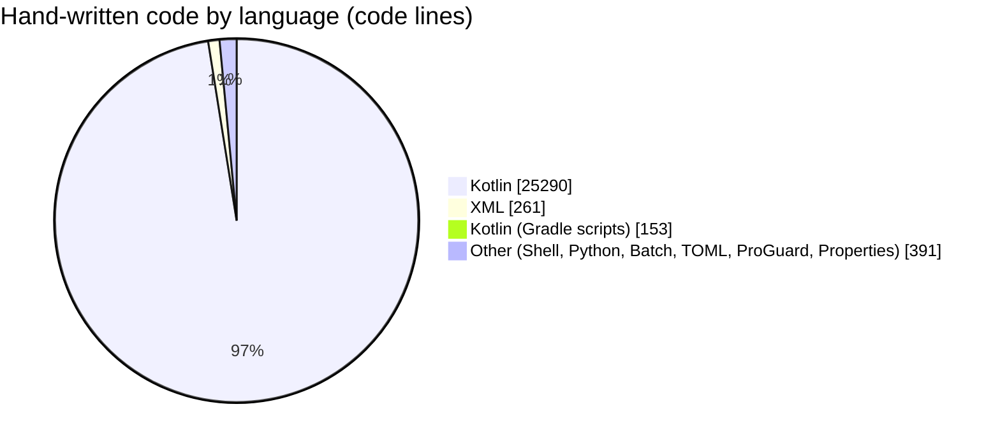

# Code statistics

A snapshot of the codebase size at commit `7723420` (2026-11-14). Not documentation: just numbers.

- **Code lines** exclude blank lines and comment lines (`//`, `/* */`, KDoc, `#`, `<!-- -->`).
- Only git-tracked text files are counted. Images and the Gradle wrapper jar are excluded.
- Regenerate with `python3 tools/code_stats.py` from the repo root.

## Headline

| | Code lines |
|---|---:|
| App code (Kotlin, `app/src/main`) | 13,682 |
| Test code (Kotlin, `app/src/test`) | 11,608 |
| All hand-written code (app, tests, build, resources) | 26,095 |
| Everything tracked, including generated schemas and docs | 38,922 |

Tests are 0.85 lines for every line of app code.

## App code by component

| Component | Files | Code | Comments | Blank |
|---|---:|---:|---:|---:|
| UI screens and ViewModels (ui/) | 50 | 8,566 | 2,072 | 578 |
| Repositories (data/repository) | 21 | 2,127 | 1,078 | 304 |
| Local database (data/local) | 36 | 1,023 | 466 | 225 |
| TMDB client (data/remote) | 19 | 445 | 79 | 77 |
| Recommender (data/recommend) | 10 | 423 | 270 | 79 |
| Background work (work/) | 6 | 345 | 174 | 41 |
| Search logic (data/search) | 4 | 311 | 85 | 37 |
| Root and common (MainActivity, app class, BuildStats, common/) | 4 | 193 | 113 | 19 |
| Dependency wiring (di/) | 1 | 164 | 28 | 26 |
| Backup and restore (data/backup) | 1 | 85 | 46 | 10 |
| **App total** | **152** | **13,682** | **4,411** | **1,396** |

## Everything else

| Area | Files | Code | Comments | Blank |
|---|---:|---:|---:|---:|
| Tests (app/src/test) | 82 | 11,608 | 1,473 | 2,203 |
| Android resources (app/src/main/res) | 10 | 228 | 19 | 12 |
| Build and tooling (Gradle, scripts, config) | 12 | 577 | 180 | 99 |
| Room schema exports (generated JSON) | 11 | 7,514 | 0 | 0 |
| Docs and project notes (Markdown) | 39 | 5,313 | 0 | 887 |
| **Grand total (all areas)** | **306** | **38,922** | **6,083** | **4,597** |

## Languages

### Hand-written code

Excludes the generated Room schema JSON and the Markdown docs. There is no Java, C or C++ in the repo. The only Python is the stats script, `tools/code_stats.py`.

| Language | Files | Code lines | Share |
|---|---:|---:|---:|
| Kotlin | 234 | 25,290 | 96.9% |
| XML | 11 | 261 | 1.0% |
| Kotlin (Gradle scripts) | 3 | 153 | 0.6% |
| Shell | 2 | 120 | 0.5% |
| Python | 1 | 103 | 0.4% |
| Batch | 1 | 73 | 0.3% |
| TOML | 1 | 64 | 0.2% |
| ProGuard | 1 | 16 | 0.1% |
| Properties | 2 | 15 | 0.1% |
| **Total** | **256** | **26,095** | **100%** |

Kotlin, including the Gradle build scripts, is **97.5%** of hand-written code.

### Everything tracked

| Language | Files | Code lines | Share |
|---|---:|---:|---:|
| Kotlin | 234 | 25,290 | 65.0% |
| JSON | 11 | 7,514 | 19.3% |
| Markdown | 39 | 5,313 | 13.7% |
| XML | 11 | 261 | 0.7% |
| Kotlin (Gradle scripts) | 3 | 153 | 0.4% |
| Shell | 2 | 120 | 0.3% |
| Python | 1 | 103 | 0.3% |
| Batch | 1 | 73 | 0.2% |
| TOML | 1 | 64 | 0.2% |
| ProGuard | 1 | 16 | 0.0% |
| Properties | 2 | 15 | 0.0% |
| **Total** | **306** | **38,922** | **100%** |

